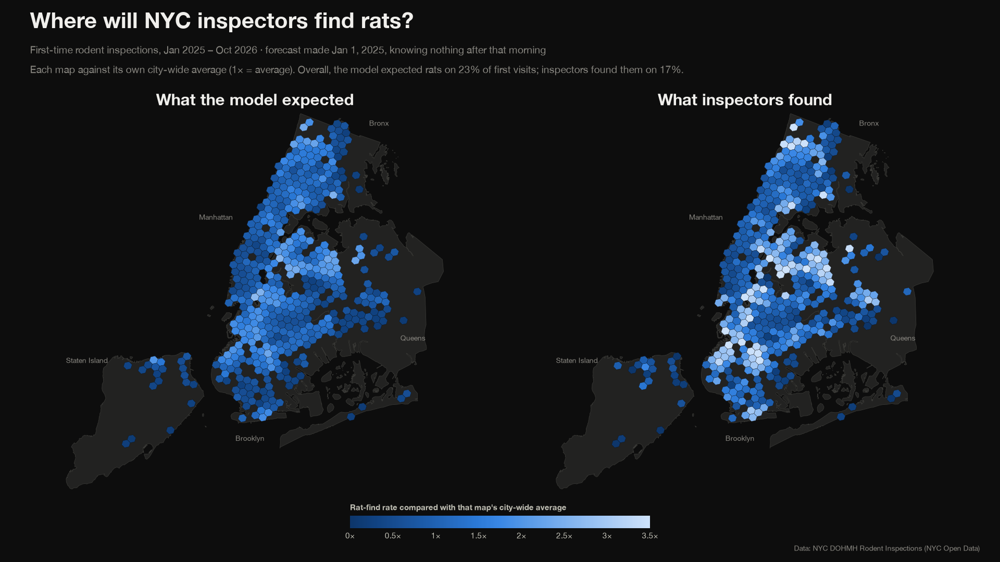
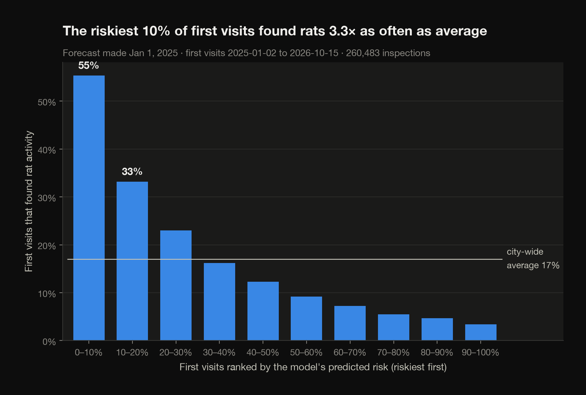
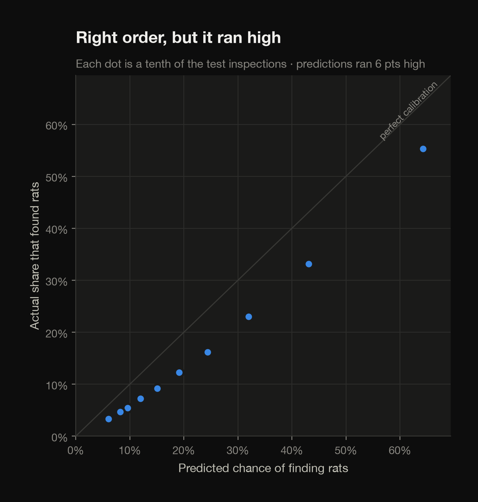
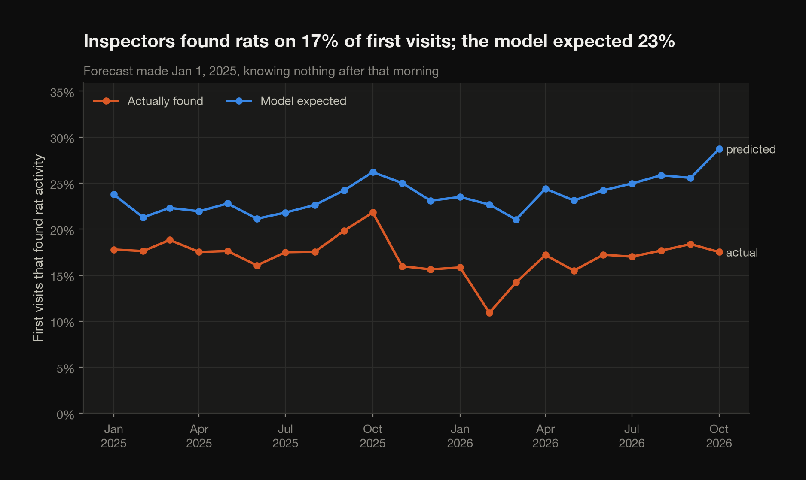
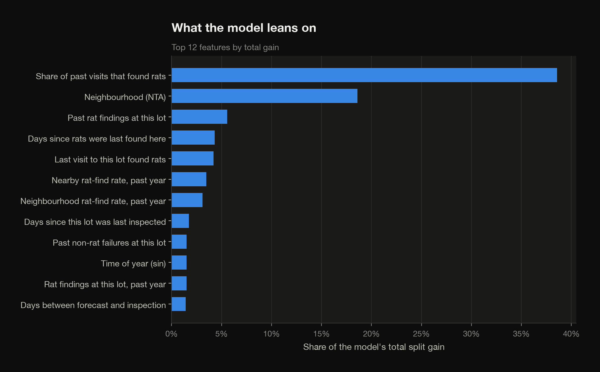
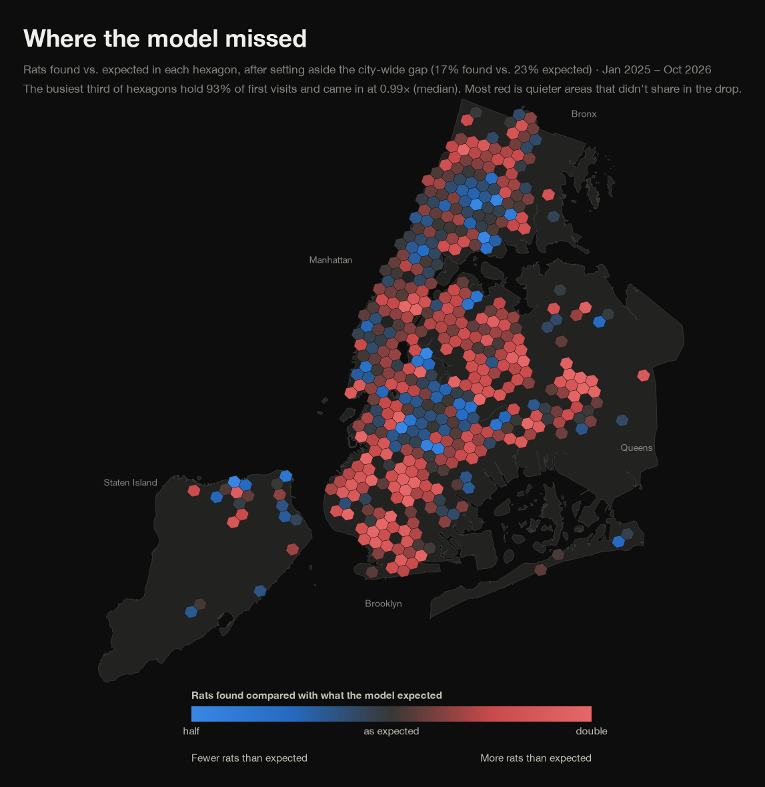

# NYC Rat Forecast

[Explore the interactive map](https://sujar-henry.github.io/nyc-rat-forecast/)

On January 1, 2025, could a model have predicted where New York City's rodent inspectors would find rats over the next two years? This project trains an XGBoost model on 15 years of city inspection records, freezes everything it knows on that morning, and maps its forecast next to what inspectors actually found.



The forecast covered 260,483 first-time inspections from January 2025 to October 2026. Across 464 neighborhood-sized hexagons, the model's map matches reality at r = 0.79. Simply reusing 2024's map scores 0.73, and two random halves of the real 2025–26 data agree with each other at only 0.83, which is about as close as any forecast could get.

## The data

[Rodent Inspection](https://data.cityofnewyork.us/Health/Rodent-Inspection/p937-wjvj) from the NYC Department of Health and Mental Hygiene, via NYC Open Data. At download time it held **3,140,681 records**.

These are inspection records, not a count of rats. Each row is one visit to one property (identified by its borough-block-lot number), with a date, a location and a result:

| Visit type | Records | What it is | Found rat activity |
|---|---:|---|---:|
| Initial | 2,163,593 | First inspection, usually after a 311 complaint or a proactive sweep | 15.6% |
| Compliance | 482,023 | Follow-up after a property failed | 40.7% |
| Treatments | 477,203 | Baiting or monitoring by city exterminators | n/a |
| Stoppage | 14,426 | Burrows sealed | n/a |
| Clean Ups | 3,436 | Debris removed | n/a |

The model predicts **first-time (Initial) inspections**, and the label is 1 when the result is `Failed for Rat Activity` or `Failed for Rat Activity and Other Reason`. Every other visit type, follow-ups included, is used only as history.

## How it works

```
download → clean → features → train → evaluate → maps → site
```

**Cleaning** (`clean.py`) parses dates, drops the handful of impossible ones (the raw file has inspections dated 1918 and 2045), rebuilds missing BBLs from borough/block/lot, fills missing coordinates from other visits to the same lot, and assigns every visit to an [H3](https://h3geo.org/) hexagon (resolution 8, about 0.7 km², a few blocks across).

**Every row is a forecast made on a fixed date** (`features.py`). For a forecast made on January 1, each first-time inspection after that date gets features describing the world *as of that morning*:

| Group | Examples |
|---|---|
| Timing | days between forecast and inspection, month, day of week, seasonal sine/cosine |
| Location | latitude, longitude, borough, neighborhood (NTA) |
| This lot's history | past inspections, past rat findings, share that found rats, days since rats were last found, days since last baiting, whether the last visit found rats |
| Nearby history | rat-find rate in the surrounding hexagon over the 90 days, year and all time before the forecast; the same for the larger parent hexagon |

History lookups live in `history.py` and only count events from strictly before the forecast date, however far ahead the inspection is.

**The model learns the same task it's tested on.** Training rows are forecasts made every January 1 from 2010 to 2023, each covering up to two years ahead but never reaching 2024. A forecast made on January 1, 2024 decides when to stop training, and the test is the forecast made on January 1, 2025.

| Split | Forecasts | Rows | Found rats |
|---|---|---:|---:|
| Train | Jan 1, 2010 … Jan 1, 2023 (14) | 3,347,195 | 14.9% |
| Validation | Jan 1, 2024, for 2024 | 154,264 | 22.9% |
| Test | Jan 1, 2025, for Jan 2025 – Oct 2026 | 260,483 | 17.0% |

The model is a gradient-boosted tree classifier (`xgboost`, histogram method, native categorical support, depth 8, learning rate 0.05), early-stopped on validation log loss at 75 trees. AUC is 0.804 on train, 0.792 on validation and 0.783 on test, so it isn't overfitting.

### How a leak was caught

The first version of this project let each inspection use everything known up to the day before it. No inspection could see its own result, and the tests confirmed that, but the side-by-side maps matched almost perfectly (r = 0.95). That's suspicious. Two random halves of the real data only agree at 0.83, and a forecast shouldn't beat reality's agreement with itself.

There were two causes:

1. **Rolling history.** An inspection in March 2026 used the rat-find rate on its block over the past 90 days, which came from late-2025 inspections. Those same inspections make up the "actual" map, so the predicted map was partly a delayed copy of the answer.
2. **Follow-up visits.** A compliance visit only happens after a property fails. Predicting 2025–26 follow-ups meant the model "knew" about 2025–26 failures just from the visit being on the schedule.

Freezing history at the forecast date and predicting first visits only fixed both. `tests/test_features.py` now rewrites every outcome after the forecast date and asserts that no test-set feature moves. Putting the old rolling history back makes that test fail.

## Results

All numbers are for the forecast made on January 1, 2025, scored against first-time inspections through October 2026.

| | ROC AUC |
|---|---:|
| **XGBoost model** | **0.783** |
| Rule of thumb: this lot's past rat-find rate | 0.751 |
| Rule of thumb: last year's rate in this hexagon | 0.627 |

Average precision is 0.474 (against a 0.17 base rate), log loss 0.390 and Brier score 0.120.

Ranking first visits by predicted risk:

- The riskiest 10% found rats **55%** of the time, 3.3× the city-wide 17%.
- The riskiest 20% account for **52%** of all rat findings.
- The least risky half found rats only **6%** of the time.

<p>
  
  
</p>

**It ranked well but ran high.** The model expected rats on 23.4% of first visits, and inspectors found them on 17.0%. That isn't a bug: first-visit rat-find rates sat between 21% and 26% every quarter from 2022 through 2024, then dropped to 14–18% in every quarter of 2025 and 2026. A forecast made on January 1, 2025 had no way to see that coming. This is why the maps compare each side against its own city-wide average: they answer *where*, while the level gap is reported separately.



The strongest signal is a property's own track record: rat colonies come back to the same places. The neighborhood comes next, then the rest of the property's history (how many times and how recently rats were found there).



### Where the model missed

Red hexagons turned up more rats than expected and blue ones fewer, after setting aside the city-wide drop. Hexagons with few inspections are pulled toward "as expected" (5 pseudo-findings) so a handful of visits can't paint a big miss.

The map gives every hexagon equal room, but inspections are concentrated in a few places. The busiest third of hexagons hold 93% of all first visits and came in at 0.99× expected (median). 203 of the 247 red hexagons are quieter areas that didn't share in the 2025–26 drop.



## Outputs

| File | What it is |
|---|---|
| `outputs/maps/rat_map.html` | Interactive page: expected vs. found side by side, neighborhood search, sortable neighborhood table |
| `outputs/figures/map_predicted_vs_actual.png` | 16:9 side-by-side map (1920×1080) |
| `outputs/figures/map_predicted_vs_actual_vertical.png` | 9:16 stacked version (1080×1920) for short-form video |
| `outputs/figures/map_where_the_model_missed.png` | Found vs. expected, per hexagon |
| `outputs/figures/social_card.png` | 1200×630 link-preview image |
| `outputs/hex_predicted_vs_actual.csv` | Per-hexagon first visits, expected and found rates, relative values |
| `outputs/neighbourhood_predicted_vs_actual.csv` | The same by neighborhood (NTA) |
| `outputs/metrics.json` | Every number in this README |
| `outputs/models/model_card.json` | Features, forecast dates, hyperparameters, best iteration |

## Run it yourself

Requires Python 3.11–3.13. The [uv](https://docs.astral.sh/uv/) route:

```bash
make setup   # creates .venv and installs dependencies
make all     # download → clean → features → train → evaluate → maps → site
make test    # history and leakage tests
```

Without uv:

```bash
python3.12 -m venv .venv
.venv/bin/pip install -e ".[dev]"
make all
```

The download pulls about 3.1M rows from the NYC Open Data API in 250k-row pages and takes around 10 minutes. Finished pages are cached in `data/raw/parts/`, so an interrupted download resumes where it left off. Everything after the download takes under two minutes. Each step can also be run on its own (`make train`, `make maps`, ...).

`make site` copies the page and its preview image into `site/`, which is the published GitHub Pages repository. `make deploy` rebuilds it and pushes.

## Caveats

- **This maps inspections, not rats.** Inspections follow 311 complaints and the city's own proactive sweeps, so busy, complaint-heavy areas get inspected more. A blank hexagon means too few inspections to say, not "no rats".
- **City-wide shifts are invisible to a frozen forecast.** The 2025–26 drop is the clearest example. Re-run `make all` as new data arrives to forecast from a later date.
- **Staten Island is thin.** Many of its hexagons fall below the 25-inspection cutoff and stay blank.

## Project layout

```
src/ratcast/
  config.py      paths, dataset id, forecast dates, site URL
  download.py    paged Socrata download + borough boundaries
  clean.py       raw records → tidy, geolocated events
  history.py     point-in-time lookups (strictly-earlier sums, recency)
  features.py    forecast rows frozen at a date; yearly forecast dataset
  train.py       XGBoost fit, test predictions, model card
  evaluate.py    metrics, baselines, map agreement, figures
  maps.py        hexagon maps, social card, interactive page
  site.py        assembles the published page
  style.py       shared chart styling
  templates/rat_map.html
tests/           history, forecast and leakage tests
```

Data © City of New York, published under the [NYC Open Data terms of use](https://www.nyc.gov/home/terms-of-use.page).
